# Temperans Habits

Bring habit data together from websites, APIs, and companion apps, alongside ordinary manual logging. Temperans keeps the combined history as readable Markdown in your configured operation folder (default: `Habit Logs`) and provides calendar views, targets, and analytics. Endpoint and companion imports are core features.

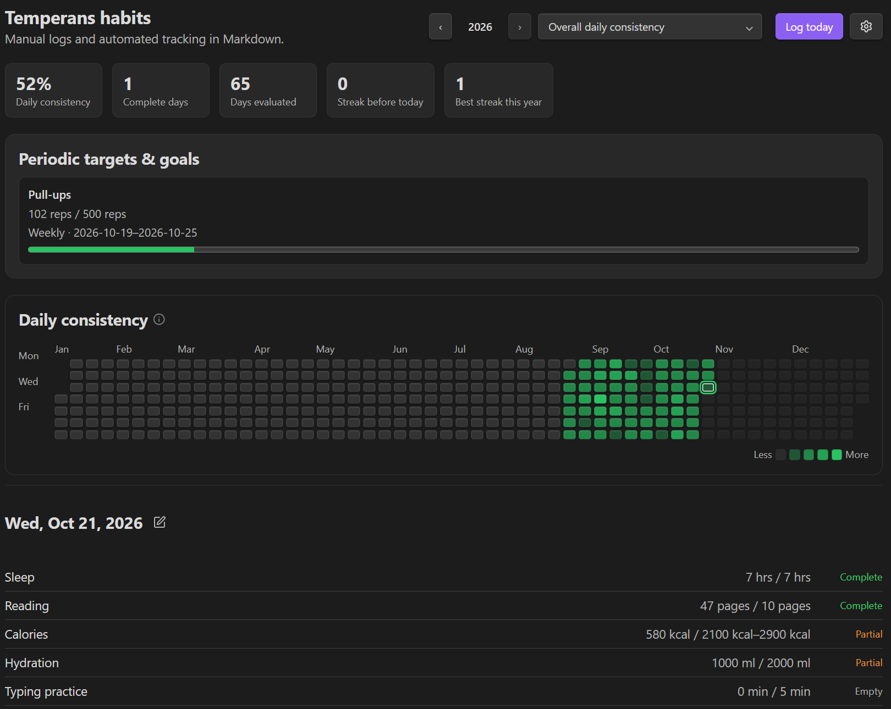

## Tasks and schedules

New installations start with just **Reading** as a clean, editable starter. You can browse presets for **Health Connect** metrics and **Connected APIs**, or create custom habits to suit your routine. Existing configurations retain their current habit list.

| Interactive heat map with hover details | Single habit focus (Sleep) |
| :---: | :---: |
| 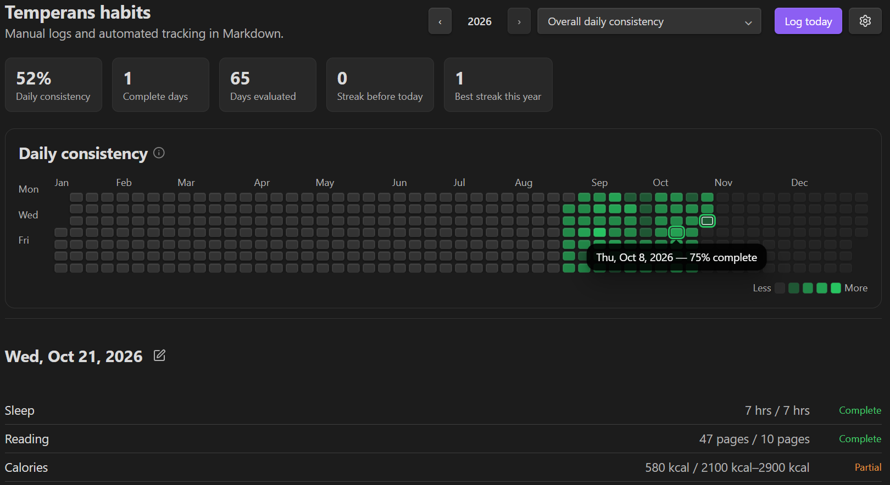 | 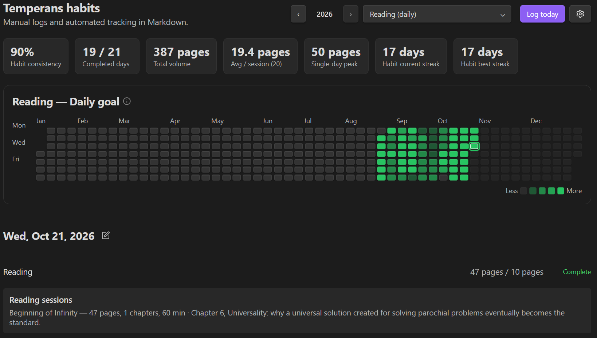 |

Manage all your habits through **Settings → Temperans Habits → Configure habits**.
- **Three Habit Archetypes**:
  - **Build Habits**: Daily, weekly, monthly, quarterly, or annual positive targets to reach (e.g. Exercise 30 min, Read 15 pages).
  - **Avoidance Habits (Negative Habits)**: Habits you want to quit or minimize (e.g. No Sugar, No Smoking, No Fast Food). Not logging or entering 0 is a success and builds your streak; entering a value above your tolerance limit registers as a slip.
  - **Zero-Goal Trackers (Non-Streak)**: Log arbitrary numerical variables (e.g. Body Weight, Mood, Blood Pressure, Net Worth) without target pressure. Missing a day never lowers your completion score or breaks your daily streaks.
- **Drag & Drop Reordering**: Drag the grip handle on the left of any habit card to set the authoritative order used across your dashboard, inspector, and logging modals.
- **In-Place Editing**: Tap the pencil icon next to any habit to edit its name, unit, archetype, schedule, enabled status, or target revisions.
- **Task Deletion**: Tap the trash icon to remove a task configuration while safely preserving all past journal entries in your daily logs.
- **Flexible Cadences**: Track goals on **Daily**, **Weekly**, **Monthly**, **Quarterly**, or **Annual** schedules. Non-daily goals run within their calendar boundaries and never lower your overall daily completion score.
- **Custom Units**: Choose from popular presets (pages, minutes, hours, reps, km, miles, steps, words, kcal, ml, glasses, kg, lbs, incidents) or type any custom unit (pomodoros, stretches, cards).

| Configure and reorder habits | Add a habit form |
| :---: | :---: |
| 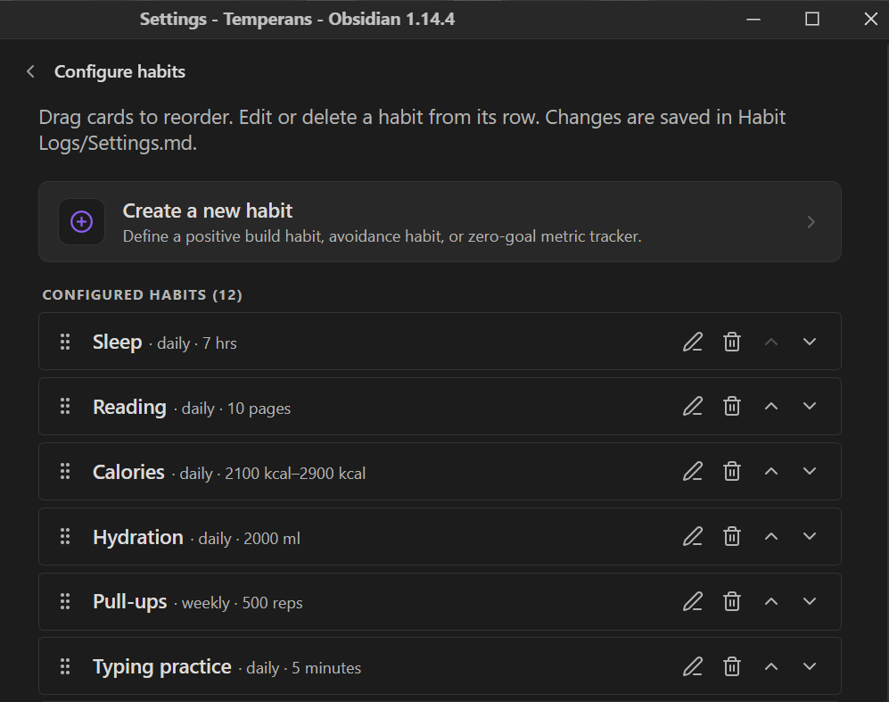 | 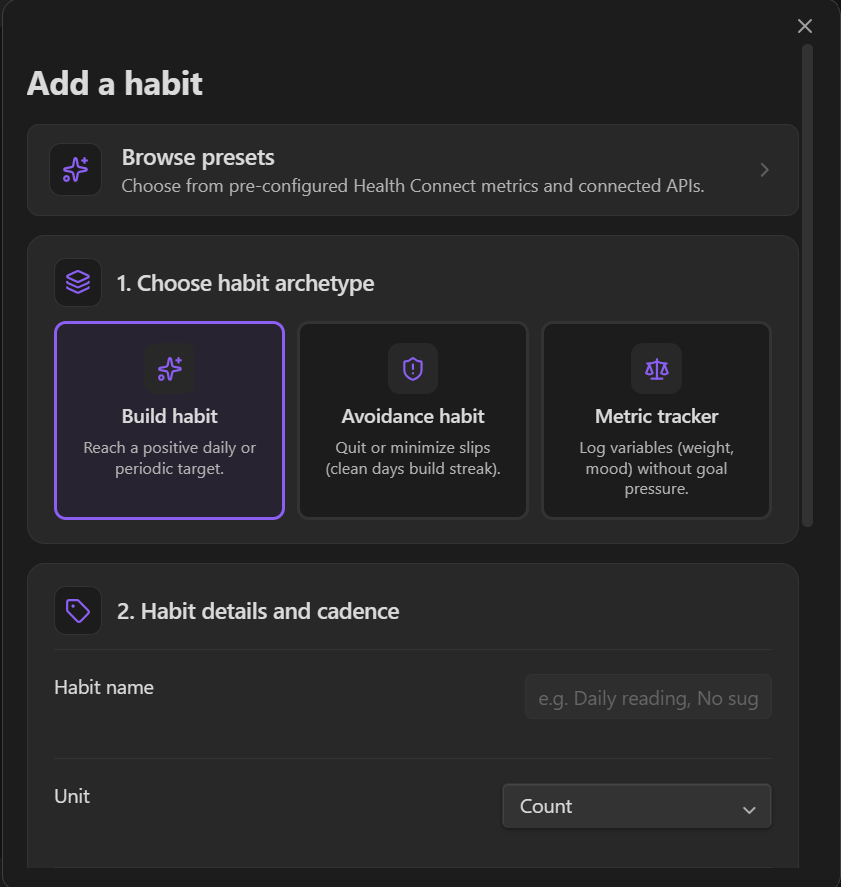 |

### Preset templates

Jump-start tracking with pre-configured templates accessible from the **Browse presets** action at the top of the habit creation form:

- **Health Connect**: Sleep duration, hydration volume, daily steps, nutrition calories, and exercise minutes.
- **Connected APIs**: GitHub contributions, Monkeytype typing duration, and Duolingo streak tracking.

To change targets or add a historic target revision manually, edit `Habit Logs/Settings.md`. For example:

```yaml
# 1. Build habit
- id: reading
  name: Daily Reading
  unit: pages
  cadence: daily
  enabled: true
  type: session
  targetHistory:
    - effectiveDate: 2026-08-21
      min: 15

# 2. Avoidance habit
- id: no-junk
  name: No Junk Food
  unit: incidents
  cadence: daily
  enabled: true
  type: avoidance
  targetHistory:
    - effectiveDate: 2026-08-21
      max: 0

# 3. Zero-goal metric tracker
- id: weight
  name: Body Weight
  unit: kg
  cadence: daily
  enabled: true
  type: tracker
  targetHistory:
    - effectiveDate: 2026-08-21
```

The dashboard automatically refreshes after a saved entry and when you edit a note directly.
- **Continuous Progress Gradient**: For any selected habit, partially completed days accurately reflect the exact percentage achieved against your goal (e.g. `12 / 15 km (80% complete)`) across 4 intensity shades instead of defaulting to a static 50%.
- **Responsive Calendar**: Full Jan–Dec 53-week view on desktop panes; interactive 7x5 monthly grid on mobile viewports.
- **Theme Harmony**: Respects your active Obsidian theme styling, fonts, and button aesthetics. Customize the heat-map accent color in **Settings → Temperans Habits → Heat-map color**.

### Mobile experience & responsive calendar

Temperans Habits adapts seamlessly across mobile devices and tablets, delivering a touch-first dashboard, responsive monthly heatmaps, and streamlined daily logging.

| Opening dashboard & actions on mobile | Mobile main dashboard view |
| :---: | :---: |
| 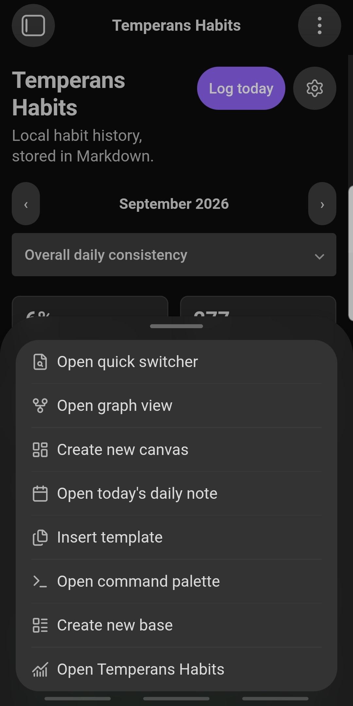 | 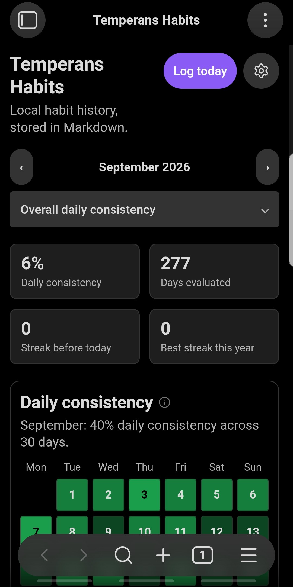 |

| Responsive 7×5 monthly heat map | Fast daily habit logging |
| :---: | :---: |
| 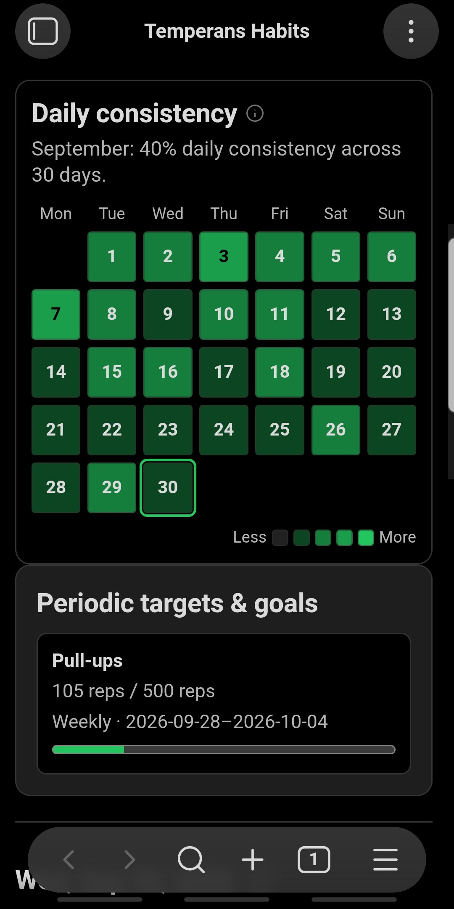 | 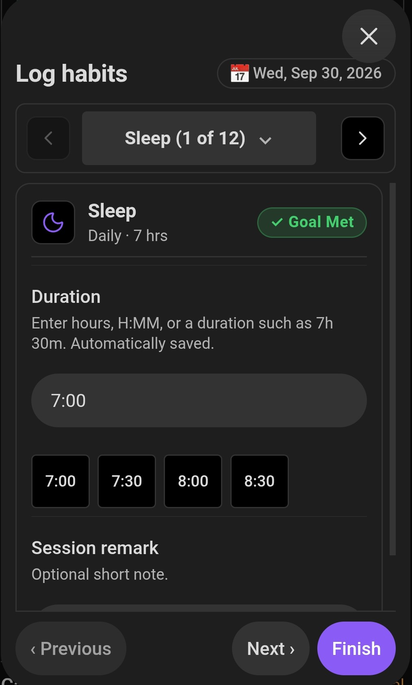 |

- **Quick Navigation**: Launch the dashboard or action menu anytime from Obsidian's mobile command palette (`Temperans Habits: Open habit dashboard`) or ribbon actions.
- **Adaptive Monthly Heatmap**: Automatically switches from the 53-week desktop view to an interactive 7×5 monthly calendar optimized for portrait mobile screens.
- **Touch-Friendly Logging**: Tap convenient quick-entry pills, enter numeric values, or type natural duration formats directly on your mobile device.

## Customize habit logging in Settings.md

Add an optional `logging` block **inside a habit** in the YAML frontmatter of `Habit Logs/Settings.md`. Omitted options retain their defaults; no extra controls appear in habit creation. Save the note and reopen the logger to see changes.

For example, an existing minutes habit can include:

```yaml
  logging:
    amount:
      label: Practice time
      placeholder: "30 or 0:30"
      description: "How long did you practice?"
    remark:
      label: Reflection
      placeholder: "What improved today?"
    quickEntry:
      values: [10, 25, "0:30"]
      mode: add
      showClear: false
```

- `amount`, `remark`, and `title` accept `label`, `placeholder`, and `description`. `title` applies to session habits; `amount` changes their primary progress field. Empty strings hide default placeholder or description text.
- `quickEntry: false` hides the entire quick-entry row for that habit. A configuration object accepts `values`, `mode: add` (increment) or `mode: set` (replace), and `showClear`. `values: []` removes value buttons; set `showClear: false` to remove Clear too.
- Numeric quick entries use the habit's unit. Time strings follow the duration rules below. Existing sleep/duration habits use minutes for numeric quick entries; typing uses seconds. Explicit strings such as `"7h 30m"` or `"15m"` avoid ambiguity.
- For session habits, quick entries update the pending session's primary amount. For other habits they save immediately. Clear resets the current amount to zero, or empties the pending session field.

Time habits with units `minutes`, `hours`, or `seconds` accept ordinary numbers in that unit, `H:MM`, and explicit durations such as `1h 30m`, `90m`, or `45s`. For a minutes habit, `90`, `1:30`, and `1h 30m` all record 90 minutes. For an hours habit, `1.5` records 1.5 hours. No format toggle is needed.

Existing sleep/duration habits retain bare-hour and `H:MM` entry; typing retains bare-minute and `M:SS` entry. Both also accept explicit duration strings. Existing log values and targets keep their units.

| Daily habit logging | Goal achieved celebration |
| :---: | :---: |
| 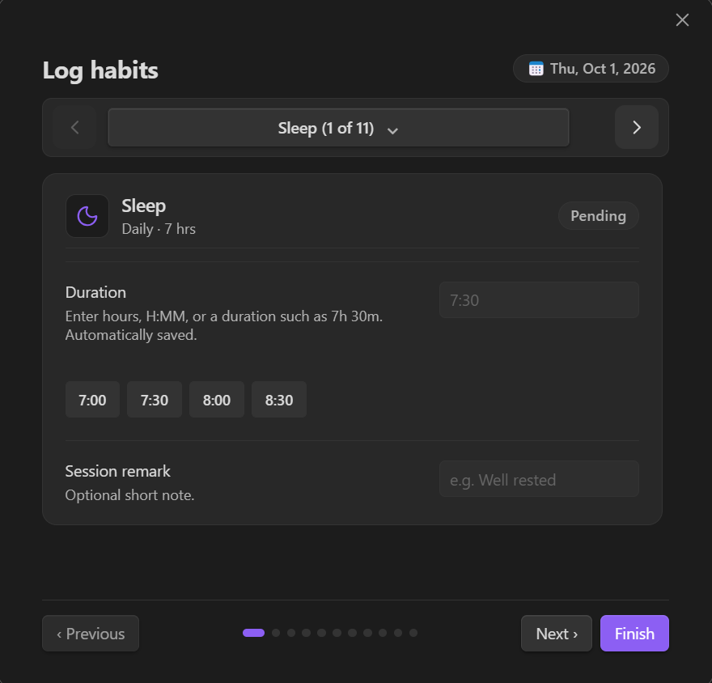 | 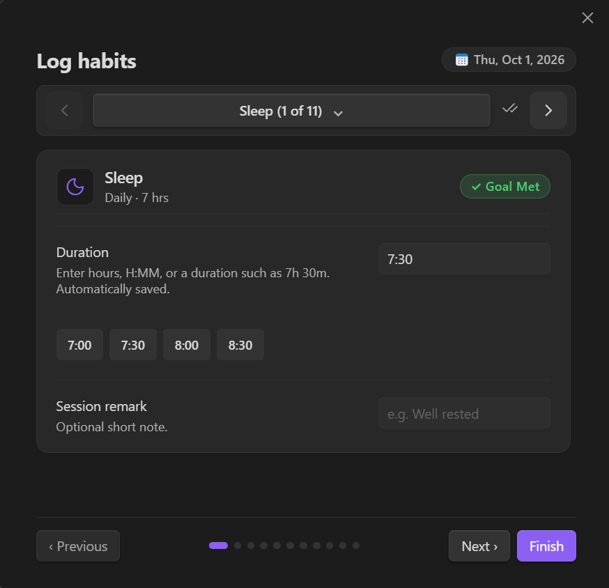 |

## Declarative dashboard configuration (`Habit Logs/Dashboard.md`)

Temperans Habits features a modular, widget-based dashboard engine. The layout, ordering, and fine-grained options of components are controlled declaratively by a dedicated Markdown note: `Habit Logs/Dashboard.md`.

You can reorder, duplicate, or omit widgets to design your own custom dashboard layout. Open `Dashboard.md` from **Settings → Temperans Habits → Customize dashboard layout** (or via the Command Palette: **Temperans Habits: Customize dashboard layout**).

### Example `Habit Logs/Dashboard.md` with full widget options

```yaml
---
temperans: dashboard
version: 1
layout:
  # 1. Header with custom title/subtitle, quick-log action, and habit dropdown
  - widget: header
    title: "My Habit Dashboard"              # Optional custom heading
    subtitle: "Daily consistency tracker"    # Optional custom description
    showActions: true                        # Show or hide Log today and action buttons
    showPeriodNav: true                      # Show or hide period navigation (‹ 2026 ›)
    showFilter: true                         # Show or hide the habit filter dropdown

  # 2. Analytics cards (pick which cards appear and in what order!)
  - widget: stats
    cards:
      - consistency         # Daily or habit consistency rate
      - total-volume        # Total volume (reps, pages, km, hours, etc.)
      - active-average      # Average on active days or per session
      - peak-day            # Single-day peak amount & date
      - current-streak      # Active consecutive streak
      - best-streak         # Longest streak this year

  # 3. Calendar & Heat Map View
  - widget: calendar        # (or widget: heatmap)
    showLegend: true        # Show or hide Less...More intensity legend
    mode: auto              # auto (responsive), year (always 53-week), or month (monthly grid)

  # 4. Periodic goals & targets (weekly, monthly, quarterly, annual)
  - widget: period-goals
    cadences: [weekly, monthly, quarterly, annual] # Specify cadences or omit to show all

  # 5. Selected day inspector & multi-entry session logs
  - widget: day-detail
    showSessions: true      # Show or hide multi-entry session logs
    showNotes: true         # Show or hide task notes

---
```

If you prefer to move `day-detail` above `calendar`, remove `period-goals`, show only a specific subset of stats cards, or force a Monthly Calendar view on desktop, simply edit `Dashboard.md`. The dashboard automatically detects changes and live-refreshes your layout. Header arrows follow the first calendar widget's mode, stepping by month (including across years) or year as configured.

Custom JavaScript widgets are not part of this release. Old `script` entries in Dashboard.md are ignored; remove them from the layout. Declarative built-in widget customization remains supported.

## Embedded Markdown Codeblocks (```temperans-dashboard)

Because all widgets are modular components, you can embed live, interactive habit summaries directly into your journal, homepage, or project notes:

````markdown
```temperans-dashboard
habit: reading
year: 2026
widgets:
  - stats
  - calendar
  - day-detail
```
````

Or embed just a specific habit's streak and heat map:

````markdown
```temperans-dashboard
habit: reading
widgets:
  - stats
  - day-detail
```
````

Embedded codeblocks are reactive and automatically update when you log or edit habits.

## Habit analytics & performance insights

Temperans Habits provides a generic analytics engine that automatically computes deep metrics for **any** task:

* **Interactive In-Dashboard Analytics**:
  Selecting any habit from the dashboard dropdown transforms the statistics cards into that task's dedicated metrics:
  * **Consistency rate**: Percentage of elapsed days or periods meeting target.
  * **Total volume**: Cumulative reps, pages, hours, milliliters, or count across the year.
  * **Average on active days** (or **Average per session** for multi-entry habits like Reading or Workouts).
  * **Single-day peak**: Highest recorded amount with exact date.
  * **Habit current streak & best streak**: Dedicated consecutive streaks for that specific task.
  * For weekly/monthly habits: Period success rate (e.g. `32 / 34 weeks`), average per week, and best period total.
* **Side-by-side Analytics Summary**:
  Run **Temperans Habits: Open habit analytics summary** (or choose **Analytics summary** in Habit actions) to open an all-in-one report comparing all your configured tasks side-by-side with volume, averages, and streaks.

| Quick actions palette | Comprehensive analytics summary |
| :---: | :---: |
| 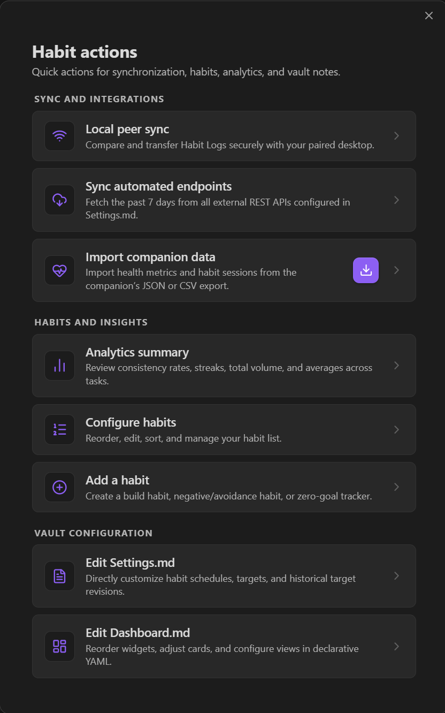 | 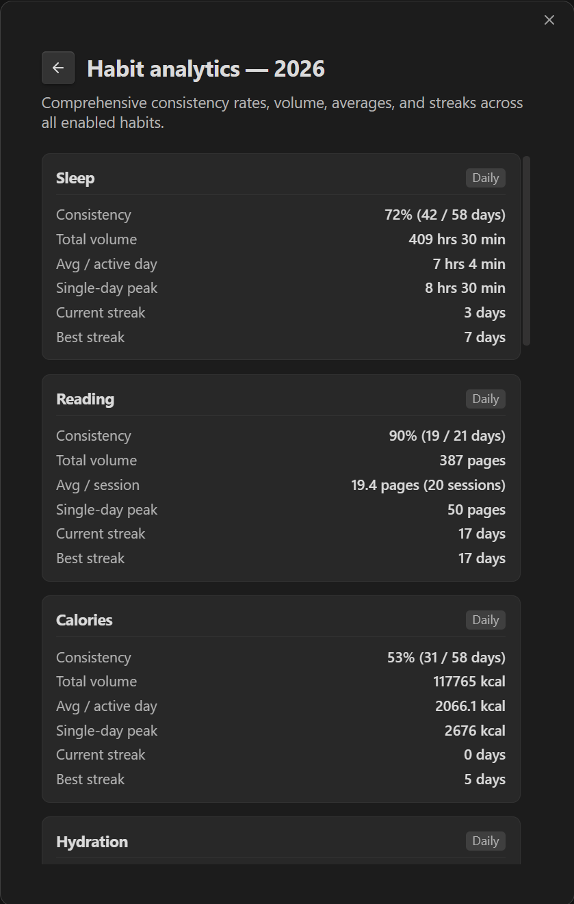 |

## Automated API sync

Add an `endpoint` block to a habit in `Habit Logs/Settings.md` to fetch and map data from an HTTP API. The runner supports one request per sync, JSON responses, date templates, standard HTTP methods, headers, request bodies, and optional authentication. API secrets are stored in Obsidian Secret Storage. Imported values use `sourceName` (or `endpoint` by default), and existing manual entries are protected.

```yaml
- id: api-metric
  name: External metric
  unit: count
  cadence: daily
  enabled: true
  type: tracker
  targetHistory:
    - effectiveDate: 2026-01-01
  endpoint:
    sourceName: example-api
    url: "https://api.example.com/records?from={{startDate}}&to={{endDate}}"
    response:
      recordsPath: data
      dateField: date
      valueField: value
      aggregation: sum
```

Response mapping supports arrays or date-keyed objects. Use `aggregation` (`sum`, `count`, `max`, `latest`, or `average`) and optional numeric `valueTransform` (`divideBy:<number>` or `multiplyBy:<number>`). For JSON responses that contain a text field with a numeric value, `valuePattern` can extract the first capture group. Templates include `{{today}}`, `{{startDate}}`, `{{endDate}}`, and ISO or epoch variants.

Use **Settings → Temperans Habits → Automated API endpoints** to store credentials, test a request, or sync the past seven days. See the [API gallery](https://adg0.github.io/temperans/#api-gallery) and the [copyable YAML examples](examples/).

## Third-party integrations

The Android companion exports Health Connect data to a local staging file in the vault. Temperans imports supported values for enabled habits. See the [companion guide](android-companion/README.md) for setup and supported metrics.

## Local peer sync

Transfer habit configurations (`Habit Logs/Settings.md`) and dated daily logs securely between desktop and mobile over your local Wi-Fi with authenticated AES-256-GCM encryption — zero cloud accounts or third-party servers required.

### 1. Desktop host setup & QR generation

Open **Temperans Habits: Open local peer sync** (or go to **Settings → Temperans Habits → Local peer sync**) on your desktop computer and click **Start temporary host**. A pairing QR code is generated instantly alongside your local network IP and pairing code:

| Desktop Peer Sync host setup | Generated QR code & pairing credentials |
| :---: | :---: |
| 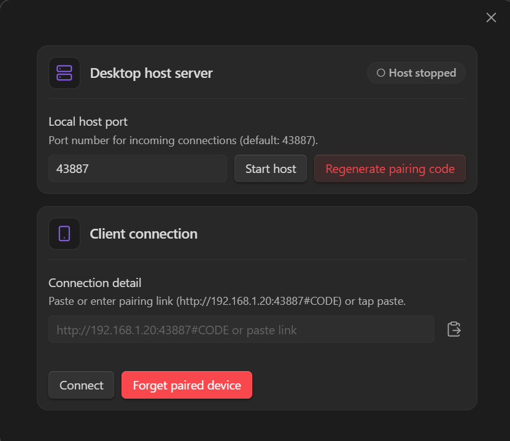 | 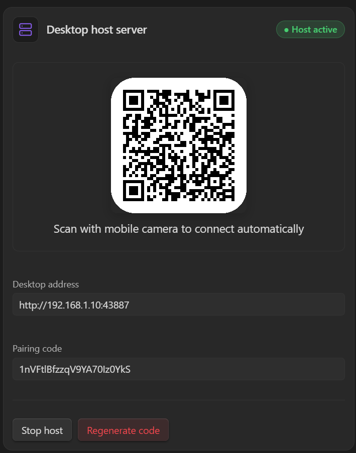 |

### 2. Mobile connection & transfer preview

On your mobile device:
- **Native Camera Deep Link**: Point your standard camera or Google Lens at the desktop QR code. Tapping the detected `obsidian://temperans-pair` link opens Obsidian and configures the paired desktop profile instantly.
- **Clipboard Fallback**: Tap **Paste pairing from clipboard** inside the mobile Peer Sync modal to configure URL and pairing code in 1 tap.

| Scanned QR pairing detected | Connected to desktop host |
| :---: | :---: |
| 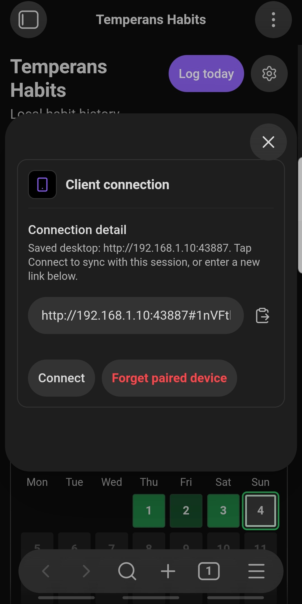 | 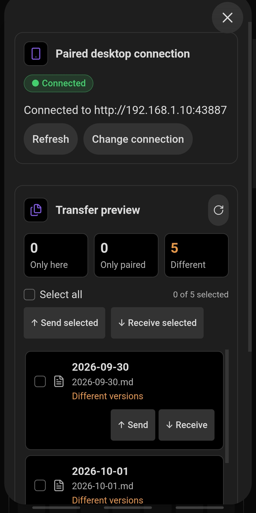 |

| Transfer preview & version comparison | Transferring selected notes | All files caught up |
| :---: | :---: | :---: |
| 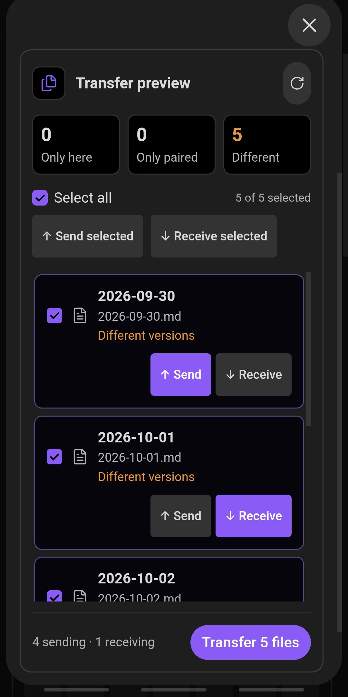 | 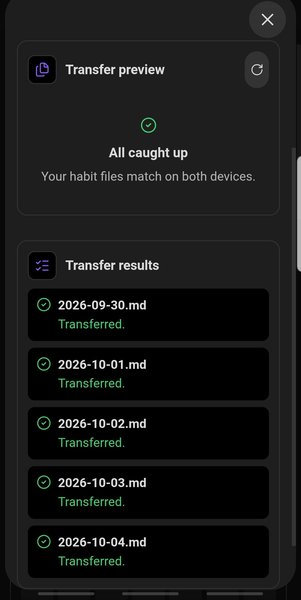 | 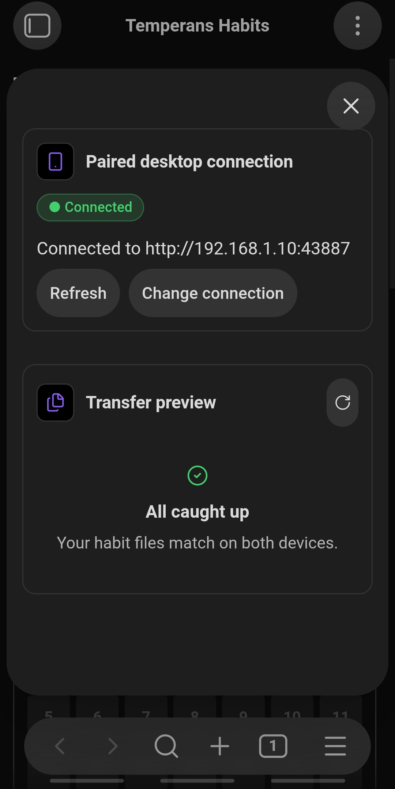 |

- **Side-by-Side Comparison**: The transfer preview clearly indicates whether each file is **Up to date**, **Only here**, **Only on paired device**, or has **Different versions** (colored status pills).
- **Directional Control**: Choose whether to **Send** ($\uparrow$) or **Receive** ($\downarrow$) individual files, or tap **Transfer selected** to synchronize all pending changes at once.
- **Cryptographic Safety**: Peer sync requires mutual challenge-response authentication and AES-256-GCM encrypted RPC, with session keys derived through PBKDF2 (100,000 iterations) and a fresh session salt. Pairing-key changes and host shutdown revoke sessions; replayed encrypted requests are rejected. Handshakes, request sizes, connection count, and session lifetime are bounded. Update both devices before pairing.

The temporary host listens on local IPv4 interfaces while enabled. Use a trusted network and stop hosting when finished. This implementation has automated protocol coverage but has not undergone an independent cryptographic assessment.

The host is desktop-only, while Android is an outbound client. Files that differ require an explicit direction; a hash is checked again immediately before overwrite. The plugin does not configure WireGuard, discover devices through mDNS, sync automatically, or transfer any files outside `Habit Logs`.


## Data ownership

All targets and daily logs live as Markdown/YAML in your vault. New logs default to plain `Habit Logs/YYYY-MM-DD.md` filenames.

In **Settings → Temperans Habits → Storage & Preferences**:

- **Organize logs by year and month** enables `YYYY/MM/YYYY-MM-DD.md`. It is off by default.
- **Custom date format** accepts [Moment formatting tokens](https://momentjs.com/docs/#/displaying/format/), such as `DD-MM-YYYY`, `YYYY/MMMM/DD-dddd`, or `[Practice]/YYYY-MM-DD`. Enter the format without `.md`; the example path updates while you type. Click **Save format** or press Enter to apply it.

With year/month organization off, the saved custom format applies, or `YYYY-MM-DD` by default. Formats must identify a complete date and produce valid paths inside the operation folder.

Changing the naming mode never moves or renames existing notes. Temperans updates an existing day's note in place and discovers old custom names using their stored ISO date, so flat, nested, and custom histories can coexist. Notes retain their body text and unrelated frontmatter. Peer sync identifies daily files by date and uses the receiving device's chosen layout for new files, keeping existing destination paths intact. Settings.md and Dashboard.md keep their existing locations.

New and edited daily logs use one consistent top-level map per task: `typing`, `reading`, and custom habits. Numeric tasks use `value`, `source`, and an optional `note`; typing adds `value_unit`, `tests`, and imported results, while multi-entry habits use `sessions` with optional notes. This keeps every integration’s write path predictable without a separate metadata block.

```yaml
temperans: habit-log
temperans_schema: 3
date: 2026-08-22
calories: { value: 2200, source: health-connect }
guitar: { value: 15, source: manual }
typing:
  value: 930
  value_unit: seconds
  tests: 21
  source: monkeytype
  imported: []
reading:
  sessions: []
```

Obsidian plugin storage retains local display/configuration state; the optional Monkeytype ApeKey and peer-sync pairing secrets use Obsidian Secret Storage. Health Connect staging data remains only in the selected local vault folder until replaced by the companion or removed by you.

The plugin and companion have no hosted backend or telemetry. Optional endpoint integrations contact the services you configure. Local peer sync transfers selected habit files, which can contain health data, to the paired device.

Stat cards automatically scale large values for readability: 100,000 ml becomes 100 L, 300 minutes becomes 5 h, and 1,000 hours becomes 41.7 days. Other large counts use k, mn, and bn suffixes. Card values are rounded to one decimal place; stored values, logging inputs, and goals keep their original precision and units. Save feedback appears as a quiet icon beside the selected habit name, with status text available to assistive technology and on hover.

## History-loading performance

History discovery uses Obsidian metadata when available, then reads only the requested logs. File edits and renames update individual index entries. Parsed-log caching is bounded to 800 entries and an estimated 16 MiB serialized payload; up to four content reads run at once, shared across consumers. Large discovery and loading jobs yield to the host, and plugin unload cancels further reads.

If metadata is unavailable, discovery still reads the history in cooperative batches. Before creating a missing day, unverified metadata hints are checked against file contents so custom-named notes cannot be duplicated. These fallback checks prioritize data integrity. Dashboards show controls and daily details before broader history. Widgets request only their required dates; annual statistics retain their full yearly scope even with a month calendar. Hidden views and offscreen embeds defer history work, obsolete requests are cancelled, and matching selected-habit analytics are shared between views.

## Roadmap

**Shared challenges (exploratory, after the first release):** allow friends to contribute toward a shared target, such as one million pull-ups. Contributions would carry a separate contributor identity alongside their data source, with combined totals, individual breakdowns, contributor colors and labels, and filters for everyone, yourself, or selected friends. Sharing would be explicit per habit, with personal tracking remaining available independently.

This is a candidate for a future pilot, subject to user demand and feasibility, not a committed release feature. It would require duplicate-safe contribution records, correction/conflict handling, clear authorship and privacy rules, and aggregation appropriate to each habit. The loading architecture should support date- and contributor-scoped queries so shared histories do not add full-folder work at startup.

## Development and release verification

Use Node 22.13+ and the pinned pnpm version. Run `pnpm install --frozen-lockfile`, `pnpm typecheck`, `pnpm lint`, `pnpm test`, `pnpm build`, and `pnpm check:release`. The lint gate checks official Obsidian-specific rules; TypeScript checks run separately. Browser fixtures use pinned Playwright: install Chromium with `pnpm exec playwright install chromium`, set `BROWSER_CHANNEL=chromium`, then run `pnpm test:responsive`. Windows can use the installed Edge browser with the default channel.

See [contributions.md](contributions.md) for guidance on code changes and new endpoint examples.
